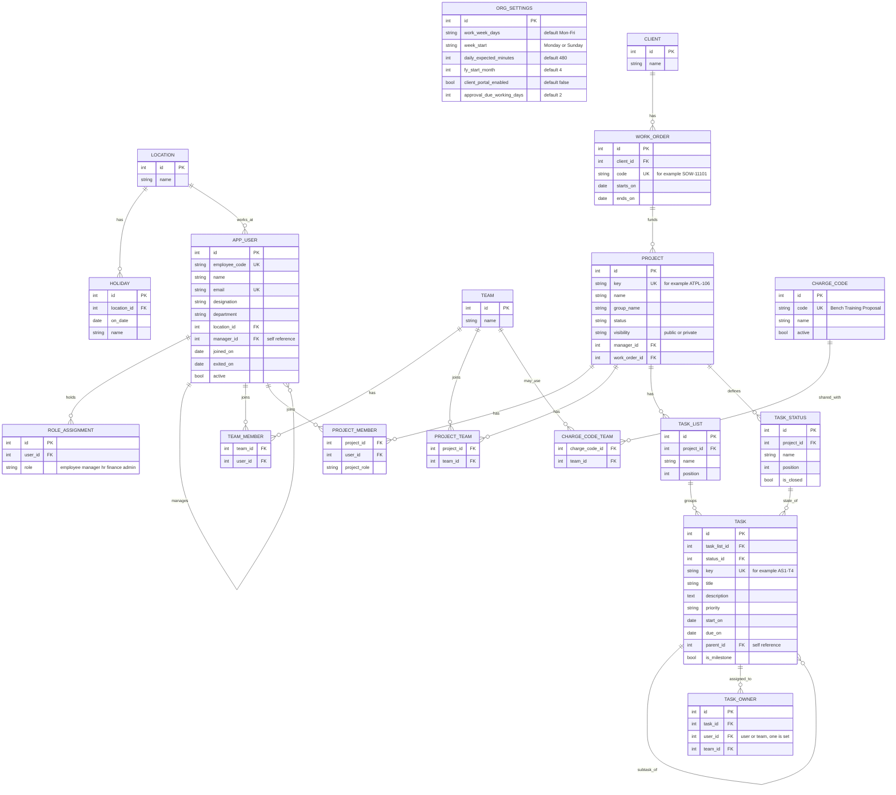
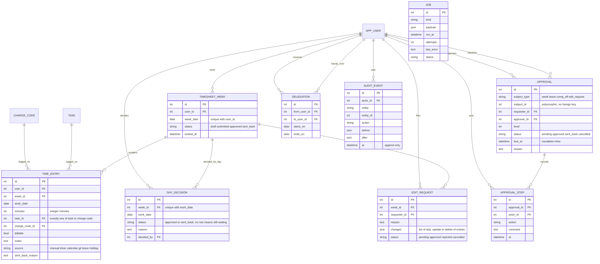
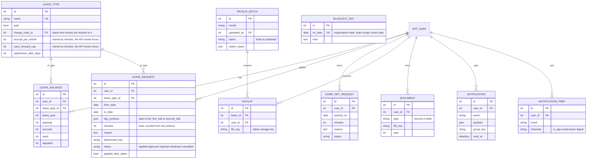

# WorkHub database ERD

Source: `documentation/docs/superpowers/specs/2026-11-12-workhub-design.md` section 5. Renders on GitHub.

Note: the user table is named `app_user` in the database because `user` is reserved in Postgres.

Conventions (apply to every table): `id` primary key, `created_at` and `updated_at` timestamps. Time is stored as **integer minutes**, dates as `date`. PK = primary key, FK = foreign key, UK = unique.

## Migration plan

| Migration | Tables | When |
|---|---|---|
| 1. Core (WH-03) | Diagrams 1 and 2: organisation, people, projects, tasks, time, approvals, audit, job | 16–20 Nov |
| 2. Leave (WH-40/41) | Diagram 3, leave tables | 2–11 Dec |
| 3. Payslips (WH-50) | Diagram 3, payslip tables | 14–16 Dec |
| 4. Notifications (WH-60) | Diagram 3, notification tables | 21–23 Dec |
| Done: approval due days (WH-32) | Column `org_settings.approval_due_working_days` | migration 0002, 16 Nov |
| Done: edit requests (WH-22) | Table `edit_request` | migration 0003, 16 Nov |
| Done: per-day approval | Table `day_decision` | migration 0004, 16 Nov |
| Done: leave (WH-40/41) | Tables `leave_type`, `leave_balance`, `leave_request`, `blackout_day` | migration 0005, 17 Nov |
| Stretch / later | `running_timer`, `suggestion`, `anomaly`, `saved_view`, `project_template`, `status_report`, `integration_account`, `repo_link`, client portal tables | after Dec 24 |

## Rules the database must enforce

- `time_entry` points to **exactly one** of `task_id` or `charge_code_id` (CHECK constraint).
- `minutes` is between 1 and 1440 per entry; the 24 h per day total is checked in the API.
- No future dates: checked in the API, not the database.
- `timesheet_week` is unique per (`user_id`, `week_start`).
- `approval.subject_type` + `subject_id` is a polymorphic reference (week, leave, comp_off, edit_request), so there is no real foreign key. The API checks it.
- `audit_event` is append-only: no update or delete grants for the app user.
- A manager can decide a whole week or one day at a time. An approved day is locked (`day_decision`); when every day with time is approved the week is approved and locked, otherwise it returns to draft and only the sent-back days go to the manager again on resubmit. A week can be edited until it is approved.
- Manager chain must not loop (`user.manager_id` is checked in the API on save).
- Approved leave writes `time_entry` rows with `source = 'leave'` in the same transaction as the balance deduction.

## 1. Organisation, people and work

## 2. Time, approvals, audit and jobs

## 3. Later migrations: leave, payslips, notifications

