# WorkHub diagram sources (Mermaid)

These are the content sources. The finished diagrams are redrawn in the Ampera skin (see the .html and .png files); Mermaid layout and styling are not used.

## 0 Context
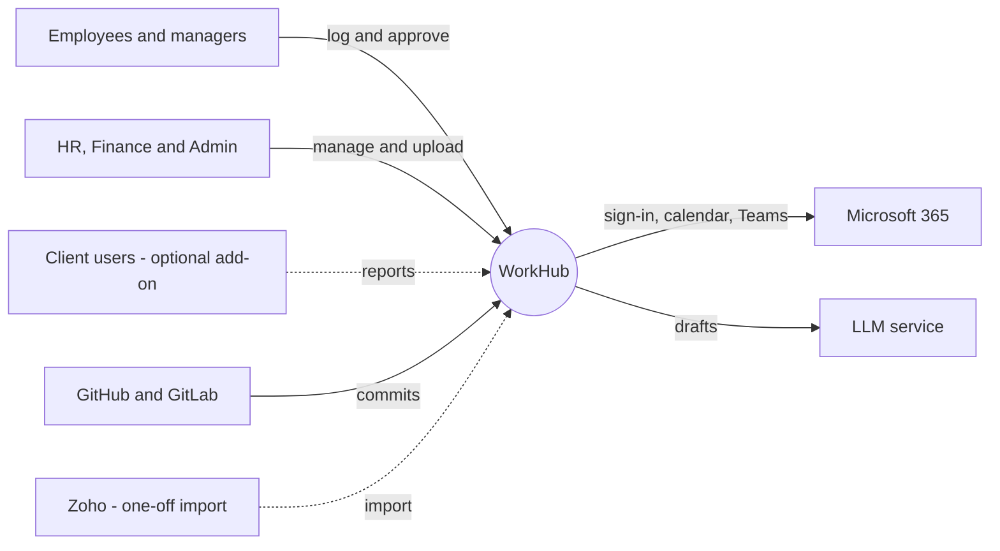

## 1 Containers
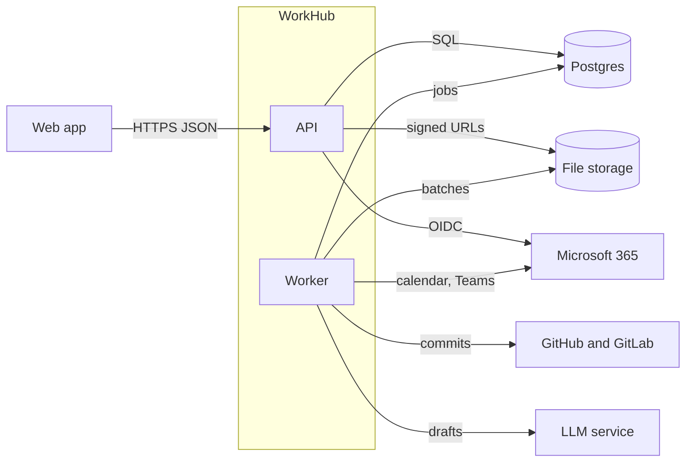

## 2 Deployment
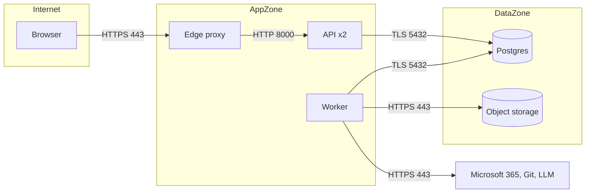

## 3 ER organisation and work
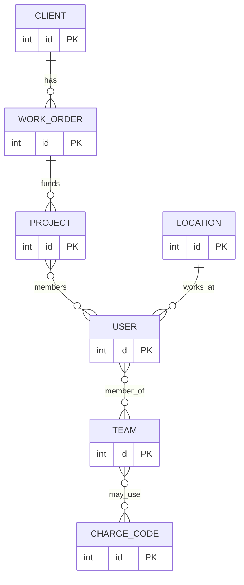

## 4 ER time and approvals
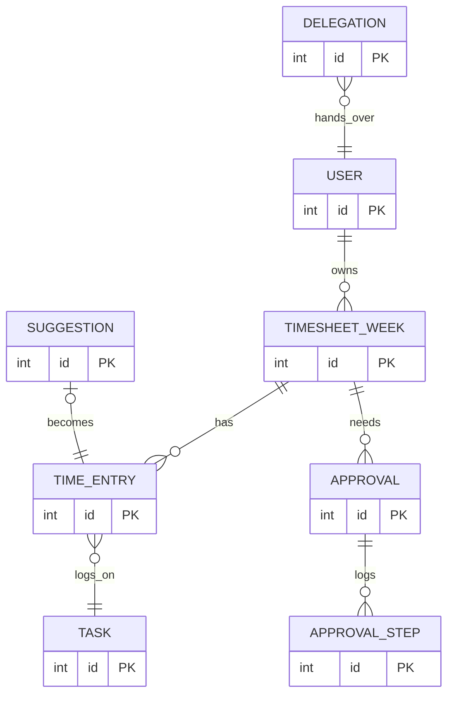

## 5 ER leave and payslips
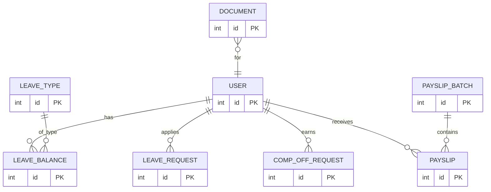

## 6 Week lifecycle
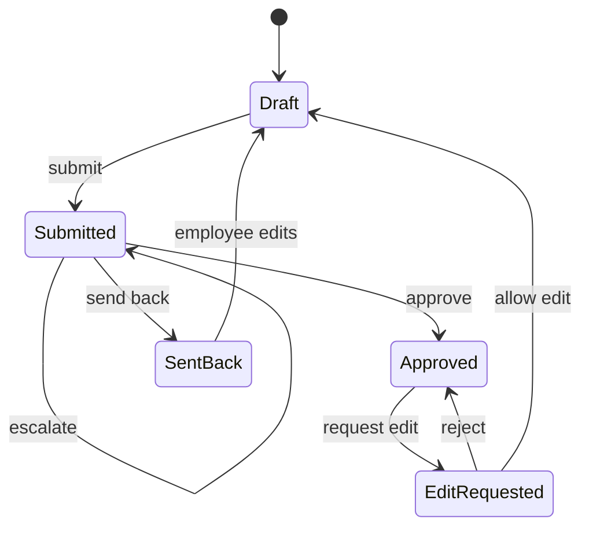

## 7 Sequence submit and approve
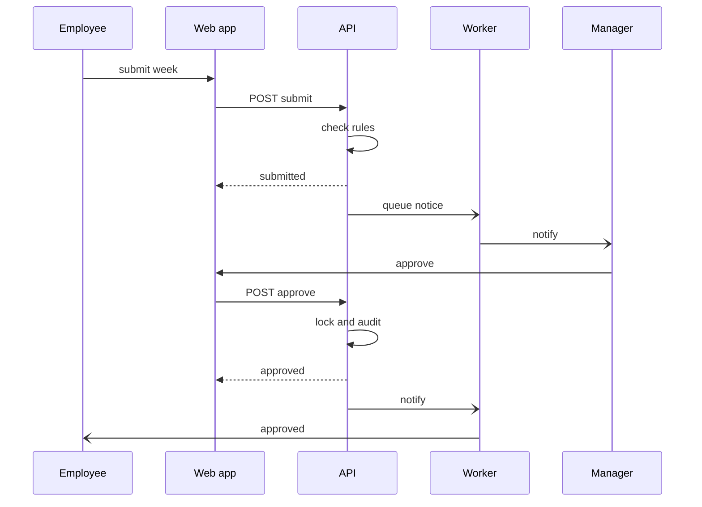

## 8 Sequence leave approval
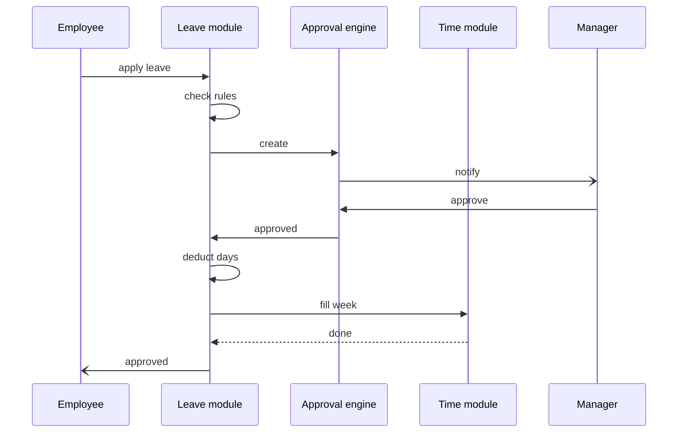

## 9 Suggestion pipeline
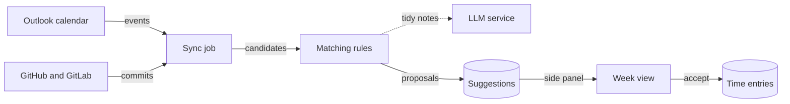

## 10 Sitemap
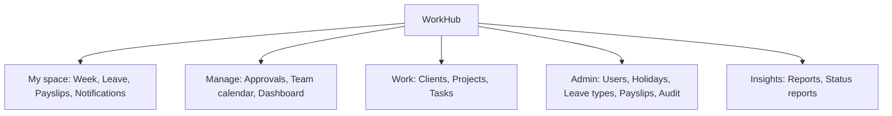

## 11 Access flow
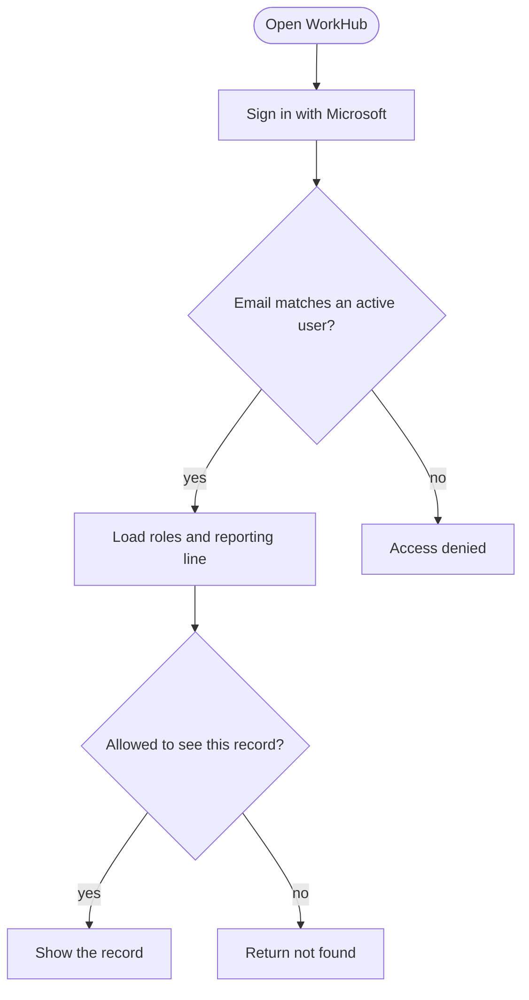
